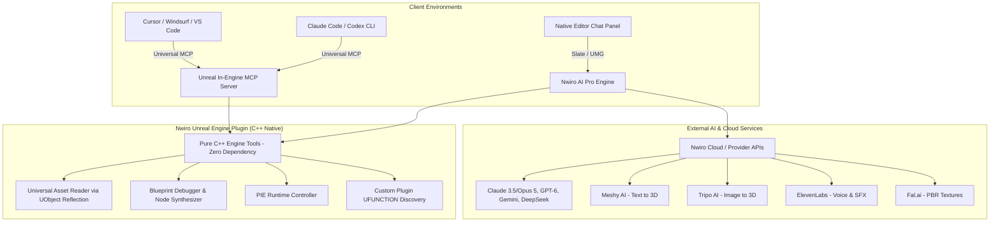

# Nwiro AI (`https://nwiro.ai/`) — Reverse Engineering Report

> **Methodology:** Analysis conducted using the [Reverse Engineer Anything (REA)](https://github.com/morluto/rea) framework via browser scenario capture (`capture_browser_scenario`), network & script extraction (`export_web_scripts`), and semantic static graph reconstruction (`analyze_javascript_application`).

---

## 1. Executive Summary & Product Architecture

**Nwiro** (developed by Leartes Studios) is an AI Assistant and editor automation system designed for **Unreal Engine 5** (compatible with UE 5.5 through UE 5.8). It is distributed via the Epic Games Fab marketplace and Leartes Cosmos in two distinct product tiers:

### The Two Product Tiers

1. **Nwiro AI Integration Kit (Perpetual / BYO-AI)**
   - **Target Audience:** Developers using AI coding assistants (Claude Code, OpenAI Codex CLI, Cursor, Windsurf, GitHub Copilot).
   - **Protocol:** Standard **Model Context Protocol (MCP)** server embedded directly into the Unreal Editor engine process.
   - **Cost Structure:** One-time purchase on Fab, zero runtime API fees to Nwiro (developers provide their own API keys or subscriptions).
   - **Tool Surface:** **209 to 216 native C++ MCP tools**.

2. **Nwiro AI Pro (Subscription / Credit-Based Copilot)**
   - **Target Audience:** Technical artists, world builders, level designers, and developers wanting an in-editor conversational UI.
   - **Interface:** Native Slate / UMG chat panel docking inside Unreal Engine.
   - **Proprietary Generative Pipelines:**
     - **Procedural Biome Generation:** Natural language to PCG graphs, vertical layering (canopy to ground cover), and Content Browser mesh mapping.
     - **Real-Scale Landscape Generation:** Real-world 1:1 elevation data mapping from names, GPS coordinates, or photos.
     - **Text-to-HDRI:** 360° 4K (3840×1920) equirectangular sky textures with real-time viewport lighting application.
     - **C++ Code Generator:** Header (`.h`) and implementation (`.cpp`) generation and automated project compilation.
   - **Tool Surface:** **224 native C++ tools** across 37 categories + integration with Unreal Engine 5.8's native 867-tool MCP registry.

---

## 2. Core Technical Architecture & Novel Engineering

### A. Zero-Dependency Pure C++ Engine Tools
Traditional Unreal automation plugins often rely on Python scripting bridges or remote Python HTTP servers. Nwiro avoids Python bridges for its core toolchain:
- Implemented as direct **native Unreal C++ modules**.
- Directly interfaces with the editor's core subsystems: `GEditor`, `UWorld`, `FBlueprintEditorUtils`, `FKismetEditorUtilities`, and `UEdGraph`.
- Eliminates IPC serialization latency between Python and C++.

### B. Universal Asset Reader via Reflection (`UObject`)
Instead of authoring dozens of custom schema parsers for individual asset types, Nwiro implements a single generic asset reader using Unreal's reflection engine:
- Iterates over `UClass` properties (`FProperty`, `FStructProperty`, `FArrayProperty`).
- Recursively inspects any `UObject` without requiring custom asset-type code.

### C. Self-Registering Plugin Tool Discovery (`UFUNCTION` Decorator)
Third-party Unreal plugins or game projects can expose custom tools directly to Nwiro’s AI prompt and MCP tool registry:
- **Mechanism:** Any C++ method tagged with a specific Unreal macro/specifier (e.g. `UFUNCTION(...)`) is discovered via engine reflection upon editor startup.
- **Advantage:** No need to link against Nwiro headers or rebuild the plugin when adding custom game-specific commands.

### D. Play-In-Editor (PIE) Runtime Controller
Unlike standard offline editor tools, Nwiro features active PIE runtime inspection and modification:
- `pie_teleport_actor`: Relocates actors in a live running game.
- `pie_set_blackboard_key` & `pie_get_blackboard_key`: Modifies AI state vectors and blackboard values on active AI controllers.
- `pie_move_ai_to` & `pie_stop_ai`: Issues runtime navigation commands to game AI agents.
- `pie_console_command`: Executes in-game console commands and queries runtime game state.

### E. Automated Blueprint Debugging & Self-Healing
The Blueprint subsystem provides agentic error detection and auto-repair:
- Breakpoints and pin watches (`bp_set_breakpoint`, `bp_add_watch`, `bp_get_watch_values`).
- Graph self-repair: Automated discovery of dangling/unconnected pins (`bp_find_unconnected_pins`), replacement of deprecated nodes (`bp_fix_deprecated_nodes`), and automatic re-linking of broken schema references (`bp_fix_broken_references`).

---

## 3. Complete Tool Catalog: 37 Categories & 224 Tools

Extracted directly from Nwiro's compiled registry definitions:

| Category | Count | Key Tools |
| :--- | :---: | :--- |
| **Blueprint** | 24 | `create_blueprint`, `edit_blueprint`, `add_interface`, `create_function_graph`, `create_event_dispatcher`, `create_widget_blueprint`, `organize_blueprint_nodes`, `render_blueprint_graph`, `reparent_blueprint`, `set_cdo_property`, `find_blueprint_nodes` |
| **Actor** | 18 | `spawn_actor`, `transform_actor`, `attach_actor`, `detach_actor`, `create_spline_actor`, `spawn_pcg_volume`, `spawn_sound`, `select_actor`, `set_actor_property`, `pie_spawn_actor`, `pie_teleport_actor` |
| **Material** | 17 | `create_material`, `edit_material`, `create_material_instance`, `edit_material_instance`, `create_material_function`, `inspect_material_graph`, `apply_material`, `set_landscape_material`, `generate_material_fal` |
| **Asset** | 11 | `find_assets`, `search_assets`, `read_asset`, `get_asset_references`, `get_asset_referencers`, `get_dependency_tree`, `find_circular_dependencies`, `find_orphan_assets`, `validate_assets` |
| **AI** | 10 | `create_behavior_tree`, `add_behavior_tree_nodes`, `create_blackboard`, `edit_blackboard`, `create_state_tree`, `add_state_tree_state`, `pie_get_blackboard_key`, `pie_set_blackboard_key` |
| **Blueprint Debug**| 10 | `bp_set_breakpoint`, `bp_remove_breakpoint`, `bp_list_breakpoints`, `bp_add_watch`, `bp_get_watch_values`, `bp_find_unconnected_pins`, `bp_fix_broken_references`, `bp_fix_deprecated_nodes`, `bp_refresh_all_nodes`, `bp_get_compile_errors` |
| **Editor / Misc** | 10 | `play_in_editor`, `stop_pie`, `take_screenshot`, `execute_python`, `read_log`, `undo`, `redo`, `list_resources`, `read_resource`, `delete_expression` |
| **Game Framework**| 8 | `create_game_mode`, `set_game_mode`, `create_game_state`, `create_player_controller`, `create_player_state`, `create_hud`, `get_game_framework_info`, `pie_get_game_state` |
| **Project / World**| 8 | `get_project_settings`, `set_project_settings`, `get_world_settings`, `set_world_settings`, `get_project_info`, `list_project_modules`, `get_build_configuration`, `get_map_check_errors` |
| **Level** | 7 | `new_level`, `open_level`, `save_level`, `create_basic_level`, `create_grid_layout`, `create_ring_layout`, `get_level_info` |
| **Animation** | 6 | `create_montage`, `add_montage_section`, `link_montage_sections`, `add_montage_notify`, `add_anim_bp_state_machine`, `read_montage` |
| **GAS (Gameplay Ability System)** | 6 | `create_gameplay_ability`, `create_gameplay_effect`, `create_attribute_set`, `list_gameplay_effects`, `list_attribute_sets`, `get_gas_info` |
| **Sequencer** | 6 | `create_sequence`, `add_sequence_track`, `add_sequence_binding`, `add_sequence_keyframe`, `set_sequence_range`, `read_sequence` |
| **Spline** | 6 | `add_spline_point`, `remove_spline_point`, `set_spline_point`, `set_spline_point_type`, `set_spline_closed`, `get_spline_info` |
| **IK Rig (UE 5.7+)**| 5 | `create_ik_rig`, `add_ik_solver`, `add_ik_goal`, `add_retarget_chain`, `read_ik_rig` |
| **Input** | 5 | `create_input_action`, `create_input_mapping_context`, `edit_mapping_context`, `delete_input_action`, `find_input_actions` |
| **Networking & World Partition** | 5 | `get_replication_info`, `set_replication_settings`, `set_net_dormancy`, `get_world_partition_info`, `load_world_partition_region` |
| **PIE Runtime** | 5 | `pie_move_ai_to`, `pie_stop_ai`, `pie_set_property`, `pie_get_property`, `pie_console_command` |
| **Rendering** | 5 | `create_light_rig`, `set_light_properties`, `set_sky_atmosphere`, `set_fog`, `set_post_process` |
| **DataTable** | 4 | `create_data_table`, `add_data_table_row`, `import_data_table_json`, `read_data_table` |
| **ElevenLabs** | 4 | `generate_voice_elevenlabs`, `generate_sfx_elevenlabs`, `generate_music_elevenlabs`, `list_voices_elevenlabs` |
| **File Editor** | 4 | `read_file`, `write_file`, `rename_file`, `delete_file` |
| **Foliage** | 4 | `add_foliage_type`, `paint_foliage`, `erase_foliage`, `get_foliage_stats` |
| **Motion Matching (UE 5.7+)** | 4 | `create_pose_search_schema`, `create_pose_search_database`, `add_pose_search_animation`, `read_pose_search_database` |
| **Niagara** | 4 | `create_niagara_system`, `add_niagara_emitter`, `set_niagara_parameter`, `read_niagara_system` |
| **PCG** | 4 | `create_pcg_graph`, `add_pcg_node`, `pcg_generate`, `find_pcg_graphs` |
| **Physics** | 4 | `set_physics_simulation`, `set_collision_profile`, `add_physics_constraint`, `get_physics_info` |
| **IK Retargeter (UE 5.7+)** | 3 | `create_ik_retargeter`, `set_chain_mapping`, `read_ik_retargeter` |
| **Navigation** | 3 | `build_navigation`, `query_navigation_path`, `get_navigation_info` |
| **UMG / Widget** | 3 | `add_widget`, `set_widget_property`, `render_widget_blueprint` |
| **Audio** | 2 | `set_audio_properties`, `get_sound_info` |
| **Landscape** | 2 | `create_landscape`, `get_landscape_info` |
| **Struct / Enum** | 2 | `create_struct`, `create_enum` |
| **Texture** | 2 | `find_textures`, `generate_texture_meshy` |
| **Meshy** | 1 | `generate_3d_model_meshy` |
| **Tripo** | 1 | `generate_3d_model_tripo` |
| **Other** | 1 | `list_gameplay_abilities` |

*(Note: In UE 5.8, an additional **867 native Epic tools** are exposed and imported through the UE 5.8 native toolset plugin registry).*

---

## 4. Release History & Evolution

Analysis of release records (`releases` object in chunk `140a72n79~zgd.js`):

- **v1.1.13 (Oct 14, 2026):** Workspace View, multi-window generation, upfront credit pricing.
- **v1.1.12 (Sep 29, 2026):** Claude Opus 5.5, GPT-6 Sol, GPT-6 Luna integration, PIE tool stability.
- **v1.1.11 (Sep 12, 2026):** Claude Fable 5.1 & GPT-6 Astra support; enhanced agent orchestration.
- **v1.1.10 (Aug 3, 2026):** Claude Opus 5, GPT-5.6, Gemini 3.6 Flash / 3.5 Flash Lite, DeepSeek V4 Flash.
- **v1.1.9 (Jul 14, 2026):** Photo-to-Terrain engine; elevation matching from heightmaps.
- **v1.1.8 (Jun 30, 2026):** Import of UE 5.8 Native MCP toolsets; single `UFUNCTION` custom tool registration.
- **v1.1.7 (Jun 21, 2026):** UE 5.8 support; Image-to-HDRI variations.
- **v1.1.6 (Jun 8, 2026):** Text-to-HDRI, widget image rendering, node-by-node PCG authoring.
- **v1.1.5 (May 27, 2026):** ElevenLabs audio extension, Fal.ai tileable PBR materials.
- **v1.1.4 (May 14, 2026):** macOS Apple Silicon & Intel native support.
- **v1.1.1 - v1.1.3 (Apr - May 2026):** Animation support, 11 languages, initial public releases.

---

## 5. Key Technical Takeaways for Our Unreal Project

1. **Native MCP Pattern:** An embedded C++ HTTP/SSE MCP server inside Unreal Editor allows external AI agents (like this IDE agent) to orchestrate Blueprints, actors, and materials with zero latency and high fidelity.
2. **Dynamic Tool Registry:** Using Unreal's reflection (`UClass` / `UFunction` iteration), custom project functions can be dynamically exposed as agent tools without hardcoded bindings.
3. **Runtime PIE Verification:** Verification loops benefit greatly from PIE tools (`pie_spawn_actor`, `pie_get_property`, `pie_move_ai_to`), enabling automated test execution inside the running viewport.
